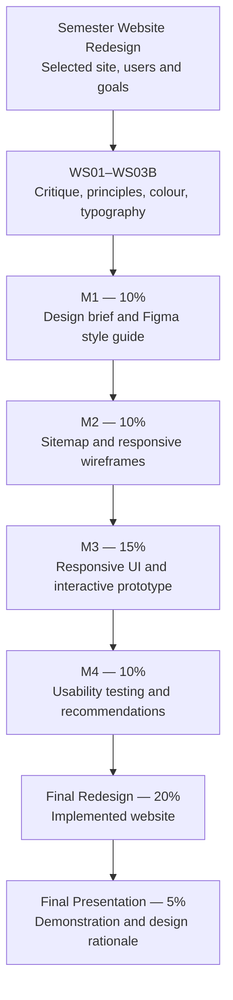
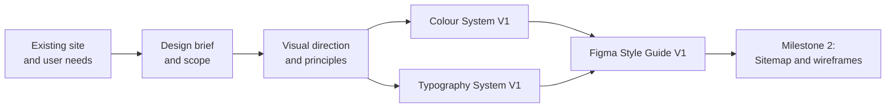

Project Milestone 1: Design Brief & Figma Style Guide

**Semester Website Redesign Project — Student Assignment | Fall 2026**
**Instructor:** Davis Boudreau
**Assessment:** Milestone 1 — **10%** of final course grade
**Due date:** As posted in Brightspace
**Delivery:** Individual semester redesign project; one persistent Figma design file, a GitHub implementation repository when coding begins, and GitHub Pages publication for the final website

---

## 1. Assignment Details

| Field                | Description                                                                                                                                                  |
| -------------------- | ------------------------------------------------------------------------------------------------------------------------------------------------------------ |
| Course               | WEBD 3100 — Web Design Fundamentals                                                                                                                         |
| Assignment           | Project Milestone 1 — Design Brief & Figma Style Guide                                                                                                      |
| Type                 | Independently developed semester website redesign project                                                                                                    |
| Prior learning       | WS01 Website Design Critique; WS02 Visual Design Principles & Usability Heuristics; WS03A Colour Design; WS03B Typography Design                             |
| Tools                | Figma, Design System Studio V4.1, browser, Brightspace; Git/GitHub and GitHub Pages in later implementation stages                                           |
| Assessment weight    | **10%**                                                                                                                                                |
| Submission           | One PDF or DOCX project report to Brightspace with a working Figma URL; the editable Figma file is the authoritative design artifact                         |
| Project continuation | M2 Sitemap & Responsive Figma Wireframes → M3 Responsive UI & Interactive Prototype → M4 Usability Test & Recommendations → Final Redesign & Presentation |

## 2. Overview — Purpose and Why This Matters

Professional website redesign starts with understanding **who the website serves, what problems need solving, and what visual system will guide the redesign**. A style guide is not simply a collection of attractive colours and fonts: it establishes repeatable design decisions that can be explained, applied, evaluated, and refined.

**Your task is to define a feasible website redesign project and create its initial Figma Style Guide (V1).** You must use your own selected website or approved project scenario. Do not simply reproduce the NSCC examples used in workshops.

**Learning progression:** Observe → Define → Analyze → Justify → Establish Tokens → Design in Figma → Verify → Document → Reflect.

### Success criteria

By the end of this milestone, you will have:

- A clear project statement, target users, problem definition, and realistic redesign scope.
- Evidence-based findings from a review of the existing website or comparable experience.
- A coherent visual direction supported by design principles and usability considerations.
- A reusable **Figma Style Guide V1** containing colour, typography, spacing, and initial interface styles.
- Evidence that selected colours and typography are readable and appropriate across intended use cases.
- A professional project report with a working, accessible Figma link and clear design rationale.

**Scope boundary:** You are **not** required to deliver a sitemap, responsive page wireframes, complete interactive prototype, working HTML/CSS website, or formal usability test in M1. These are developed in later stages. Initial example components are required only to demonstrate the style guide, not to constitute a complete component library.

## 3. Semester Project & Milestone Roadmap

**One redesign. Four milestones. One final delivery.** Each milestone extends the same project and Figma workspace. When implementation begins, students maintain their code in one GitHub repository and publish the final working website on GitHub Pages.



| Stage                  |        Weight | Main deliverable                                                          | Scope at this stage                                                     |
| ---------------------- | ------------: | ------------------------------------------------------------------------- | ----------------------------------------------------------------------- |
| **Milestone 1**  | **10%** | Project design brief and Figma Style Guide V1                             | **Required now:** project direction and visual design foundations |
| Milestone 2            |           10% | Sitemap and responsive Figma wireframes                                   | Information architecture and layout structure                           |
| Milestone 3            |           15% | Responsive UI design and interactive Figma prototype                      | High-fidelity screens and interactions                                  |
| Milestone 4            |           10% | Usability test, findings, recommendations                                 | Evidence-based evaluation and iteration                                 |
| Final Website Redesign |           20% | Implemented, tested redesign; GitHub repository and live GitHub Pages URL | Functional website, deployment, and quality assurance                   |
| Final Presentation     |            5% | Demonstration and rationale                                               | Communicate and defend decisions                                        |

*Later milestones are shown for project context. Their detailed requirements will be provided separately.*

### Semester-wide artifact management and publishing policy

**Figma — authoritative design source.** Maintain **one persistent, instructor-accessible Figma project/file** for the entire semester. Place each milestone's editable design deliverables in clearly labeled pages or sections within that same file: project brief, research, colour and typography systems, sitemap, responsive wireframes, high-fidelity screens, components, interactive prototype, usability findings, revisions, and final handoff. Do not submit screenshots or exported images as substitutes for editable Figma artifacts. Keep earlier versions or clearly identified revision evidence where useful.

**GitHub — authoritative implementation source.** When website implementation begins, create or use **one persistent GitHub repository** for the same redesign project. Commit and push HTML, CSS, JavaScript (where applicable), assets you have rights to use, documentation, and testing evidence. Use meaningful commit messages and a README describing setup, design-to-code decisions, and project status. GitHub is **not a required M1 coding deliverable**; it becomes required at the implementation stages specified in later assignments.

**GitHub Pages — live published website.** Publish the final implemented website through **GitHub Pages** and provide a working public URL. GitHub Pages is a static hosting service: if a separate backend or API is involved, its hosting and integration must be addressed separately. **A Figma prototype is not a substitute for a deployed website**, and a deployed website does not replace editable Figma design evidence.

**Brightspace — official submission point.** Submit the required report/evidence to Brightspace at each assessed stage. Include the **Figma file URL** for every design milestone; add the **GitHub repository URL** and **GitHub Pages URL** when those become applicable. Check that the instructor can access each link before submitting. Keep the same project name across Figma, GitHub, published site, and reports.

| Stage                                       | Figma design artifacts                        | GitHub source                                               | GitHub Pages publication                                       |
| ------------------------------------------- | --------------------------------------------- | ----------------------------------------------------------- | -------------------------------------------------------------- |
| **M1 — Design Brief & Style Guide**  | **Required**                            | Optional setup; no code requirement                         | Not required                                                   |
| **M2 — Sitemap & Wireframes**        | **Required**                            | Optional setup; no code requirement                         | Not required                                                   |
| **M3 — UI Design & Prototype**       | **Required**                            | Begin/maintain implementation repository as specified in M3 | Not required yet                                               |
| **M4 — Usability & Recommendations** | **Required** for findings and revisions | Maintain code changes if testing implemented features       | Use if a working site is available; detailed requirement in M4 |
| **Final Website Redesign**            | **Required** final design/handoff       | **Required** complete source repository               | **Required** live, accessible website                    |
| **Final Presentation**                | Demonstrate design evolution                  | Demonstrate implementation                                  | Demonstrate published result                                   |

**Milestone 1 boundary:** For this assignment, the required platform deliverable is the **organized, editable Figma file** plus the Brightspace report. Do not create placeholder code or an empty repository merely to satisfy a perceived GitHub requirement.

### Milestone 1 design handoff



**Instructor verification goal:** The instructor should be able to understand the proposed redesign, inspect the original site or reference material, open your Figma file, identify your design styles and tokens, and explain how your evidence supports your decisions.

## 4. Learning Outcomes Addressed

This assignment provides evidence of the following WEBD 3100 course competencies. Consult the approved course outline for the authoritative wording of learning outcomes:

- Apply design principles and usability considerations to a website redesign.
- Plan and communicate a visual direction using a design brief.
- Create reusable styles and design foundations in Figma.
- Justify design choices with reference to intended users and accessibility.
- Demonstrate professional design documentation and project organization.

**Not yet assessed in full:** responsive page mock-ups, interactive prototype flows, implemented HTML/CSS pages, and formal usability-testing findings.

## 5. Prior Knowledge and Readiness

Before beginning, confirm that you can:

- Explain visual hierarchy, contrast, consistency, alignment, and usability heuristics from WS01/WS02.
- Open and edit a Figma file, create frames, and apply named styles or variables.
- Explore the Design System Studio V4.1 colour and typography controls.
- Distinguish **foundation**, **semantic**, and **component** design tokens.
- Use the browser to inspect the existing website and document observations.
- Share a Figma file with appropriate instructor access and maintain a project repository if used by your course.

**Readiness checkpoint:** Identify the site you intend to redesign and verify that its existing interface can be reviewed. If a project has no existing site, obtain instructor approval for a comparable design scenario and document the alternative baseline.

## 6. Project Description and Use Case

Select a realistic website or application interface that would benefit from a redesign. It may be a small organization, event service, community initiative, campus-facing service, or the front end of your integrated semester application.

The design brief must answer:

1. **Problem:** What does the current experience fail to do well?
2. **Users:** Who will use the redesigned site, and what are their principal tasks?
3. **Purpose:** What outcome should the redesign support?
4. **Scope:** What is included now, and what is deferred?
5. **Constraints:** What content, brand, accessibility, technical, or project limitations must be respected?
6. **Success:** How will you know the redesign improves the experience?

Use evidence from the existing interface and prior workshop critique rather than inventing claims about actual users. Clearly label assumptions as assumptions.

## 7. Tasks and Instructions — What, Why, How

### Task 1 — Establish the project baseline

**What:** Select and document the website or approved interface scenario.

**Why:** A redesign requires a clear starting point and defined problem.

**How:**

1. Record the site name, URL (if available), purpose, and intended audience.
2. Capture **at least three annotated screenshots** illustrating the current experience (or approved baseline).
3. Identify **three concrete usability or visual design problems**.
4. Connect each problem to a design principle or usability heuristic from WS01/WS02.
5. Distinguish direct observations from assumptions about user behaviour.

**Checkpoint 1:** Can another person understand why this redesign is warranted without needing your verbal explanation?

### Task 2 — Write the design brief

**What:** Produce a concise but complete design brief.

**Why:** The brief creates a decision-making reference for all subsequent milestones.

**How:** Include the following labelled subsections:

- **Project overview:** working title and one-paragraph description.
- **Problem statement:** what is not working and why it matters.
- **Target users:** at least **two user groups or user types**, their needs, and primary tasks.
- **Redesign objectives:** **three measurable or observable objectives**.
- **Scope:** at least **three in-scope** and **two out-of-scope/deferred** items.
- **Constraints and assumptions:** brand, content, technical, accessibility, time, or integration considerations.
- **Success criteria:** at least **three criteria** that can later be evaluated through review or usability testing.

**Checkpoint 2:** Does each objective address a documented problem and an intended user need?

### Task 3 — Define visual direction and design principles

**What:** Establish a visual direction that fits the audience and purpose.

**Why:** Consistent decisions are easier to apply and defend than isolated aesthetic preferences.

**How:**

1. Identify **three guiding design principles**, such as clarity, consistency, accessibility, or hierarchy.
2. Assemble a compact visual-reference board with **at least three annotated references** (screenshots or design examples); include source attribution.
3. Describe how the proposed direction addresses the problems identified in Task 1.
4. Explain which elements of the existing identity must be preserved or can change.

**Checkpoint 3:** Can you justify the visual direction without relying only on phrases such as “modern” or “looks better”?

### Task 4 — Build Colour System V1 in Figma

**What:** Create reusable colour styles/variables and a clear colour rationale.

**Why:** Colour must support hierarchy, meaning, states, and accessibility consistently.

**How:**

1. Use **Design System Studio V4.1** to explore the palette and compare candidate colour ramps, including OKLCH where useful.
2. Establish **at least five meaningful colour roles** (for example: primary, accent, surface, text, border, feedback).
3. Document HEX values and the purpose of each role.
4. In Figma, create named colour styles or variables rather than leaving colours as unnamed fills.
5. Demonstrate **at least one light-theme example**; a dark theme is optional unless your project specifically requires it.
6. Check **at least three relevant text/background combinations** for contrast, including body text and an interactive control. Target WCAG AA contrast levels: **4.5:1 for normal text and 3:1 for large text**.
7. Show the intended default, hover, and focus-visible colour treatments for a primary action; focus visibility must not rely on colour change alone.

**Token explanation:** Document at least one mapping from a foundation value to a semantic role to a component use. A conceptual mapping is acceptable even when Figma's style organization differs from the Studio's CSS export.

**Checkpoint 4:** Can you identify where each named colour is used and explain any contrast corrections?

### Task 5 — Build Typography System V1 in Figma

**What:** Create a coherent type hierarchy and reusable text styles.

**Why:** Typography controls readability, hierarchy, and the perceived structure of content.

**How:**

1. Choose suitable typefaces and fallbacks; explain your choice and any licensing/availability constraints.
2. Use **Design System Studio V4.1** to explore a base size, modular scale, and responsive `clamp()` examples.
3. Create at least **five named Figma text styles**, including body, small/label, H1, H2, and one additional heading or display role.
4. For each style, record font family, weight, size, line height, and intended use.
5. Include a specimen showing heading, body, label, and action text together.
6. Demonstrate how typography might adapt from mobile to desktop with **at least two annotated examples**; full responsive page wireframes are not required in M1.
7. Explain one generated `clamp()` expression in plain language (minimum, fluid preference, maximum), and identify a likely CSS use case.

**Checkpoint 5:** Is the hierarchy distinguishable by more than size alone, and is body text readable at typical mobile widths?

### Task 6 — Establish spacing and initial interface styles

**What:** Define simple spacing and interface conventions that will support consistent future wireframes and components.

**Why:** A style guide needs more than a palette and type specimen to inform actual interface decisions.

**How:**

1. Document a spacing scale with **at least five steps** (for example, 4, 8, 12, 16, 24, 32 px).
2. Establish basic border-radius and border conventions, if appropriate.
3. Create a **small demonstration board** containing a heading, paragraph, card, and primary/secondary button examples.
4. Apply named Figma styles/variables to the demonstration board.
5. Annotate one example of a consistent spacing or hierarchy decision.

**Checkpoint 6:** Can you change a reusable style and see the change reflected in its intended Figma instances or text layers?

### Task 7 — Review, verify, and prepare the handoff

**What:** Test the coherence of the design system and document the result.

**Why:** The instructor and future project collaborators need to understand and reuse your decisions.

**How:**

1. Review the style guide against your project objectives and three guiding principles.
2. Recheck contrast evidence and typography readability.
3. Confirm all required Figma pages and styles are clearly named.
4. Ask a peer to locate your primary colour, body text style, and button example without assistance; record one observation and any revision.
5. Add a short **M2 handoff note** identifying how the design brief will guide the sitemap and wireframes.
6. Verify that the instructor can open the shared Figma file without requesting access.

**Checkpoint 7:** Can the instructor locate, understand, and inspect your Figma design foundation independently?

## 8. Required Deliverables and Evidence Map

Use these exact headings in your Milestone 1 report.

| ID           | Required deliverable              | Report evidence (Brightspace)                                                                       | Editable/source evidence (Figma and optional GitHub)                              | Instructor verification                                          |
| ------------ | --------------------------------- | --------------------------------------------------------------------------------------------------- | --------------------------------------------------------------------------------- | ---------------------------------------------------------------- |
| **D1** | Project baseline and critique     | Site details, three annotated screenshots, three problems with principle/heuristic connections      | Original-site reference links and project notes                                   | Problems are concrete and relevant                               |
| **D2** | Design brief                      | Problem, two user groups, three objectives, scope, constraints, three success criteria              | Figma brief page or linked project notes                                          | Project direction is feasible and clear                          |
| **D3** | Visual direction                  | Three guiding principles, three attributed visual references, rationale                             | Figma visual-reference board                                                      | Choices relate to users and brief                                |
| **D4** | Colour System V1                  | Palette, five roles, three contrast checks, state decisions, token mapping                          | Named Figma colour styles/variables and demonstration                             | Reusable colours and evidence can be inspected                   |
| **D5** | Typography System V1              | Five styles, font rationale, specimens, responsive examples, clamp explanation                      | Named Figma text styles                                                           | Typography is coherent and readable                              |
| **D6** | Spacing and UI examples           | Spacing scale, basic conventions, card and buttons, design rationale                                | Figma style-guide examples                                                        | Reuse and consistency are evident                                |
| **D7** | Verification, handoff, reflection | Peer observation, revision, M2 handoff, reflection, **persistent Figma URL and access check** | **One organized, editable Figma file** with M1 pages; GitHub optional at M1 | Instructor can access pages, inspect styles, and follow evidence |

### Evidence quality standard

Every screenshot or tool result should show **(1) what was tested or configured, (2) the relevant result, and (3) a brief explanation of what it proves**. The Design System Studio export is supporting evidence; it **does not replace editable Figma styles or a documented design rationale**.

## 9. Required Persistent Figma File Organization

Create **one semester-long Figma file** and retain it through Milestones 1–4 and the final handoff. The following page names are recommended; equivalent clearly labeled organization is acceptable. **For M1, complete pages 00–04 only; later pages are placeholders for future work.**

```text
WEBD3100 — Semester Website Redesign — [Project Name]
├── 00 — Project Overview & Design Brief       [M1]
├── 01 — Visual Research & Design Critique    [M1]
├── 02 — Colour System                        [M1]
├── 03 — Typography System                    [M1]
├── 04 — Components & Design Tokens           [M1: initial examples]
├── 05 — Information Architecture & Sitemap  [M2]
├── 06 — Responsive Wireframes                [M2]
├── 07 — High-Fidelity UI Design              [M3]
├── 08 — Interactive Prototype                [M3]
├── 09 — Usability Testing & Iterations       [M4]
└── 10 — Final Design & Handoff               [Final]
```

Use Figma's actual **pages, frames, styles, variables, and prototype connections** as appropriate; the diagram is an organization guide, not a requirement to create nested folders. Include clear frame labels and design rationale. **Do not duplicate the whole Figma file for each milestone.** Keep it accessible to the instructor throughout the semester.

### Milestone 1 access verification

1. Copy the Figma file's share link, not an individual screenshot or export URL.
2. Set appropriate view access for the instructor; editing permission is not required for grading unless separately directed.
3. Test the link in a private/incognito browser session or with an account that does not own the file.
4. Confirm the instructor can locate pages 00–04 and inspect named colour and text styles.
5. Include the same Figma URL in the report and Brightspace submission comments, if comments are available.

## 10. Report Template — Required Headings

Your report may be PDF or DOCX and should include:

1. **Cover Information:** project title, student identifier, course, milestone, date, Figma URL.
2. **D1 — Project Baseline and Critique.**
3. **D2 — Design Brief.**
4. **D3 — Visual Direction.**
5. **D4 — Colour System V1.**
6. **D5 — Typography System V1.**
7. **D6 — Spacing and Initial Interface Styles.**
8. **D7 — Verification, Reflection, and Milestone 2 Handoff (including Figma access check).**
9. **References:** external visual examples, fonts, and other borrowed resources.

**Recommended length:** concise enough to review efficiently, but complete enough to demonstrate every requirement. Prefer legible annotated evidence over repeated unlabelled screenshots.

## 11. Reflection Questions

Answer all six questions in your own words. Use concrete examples from your project.

1. Which observed problem most strongly shaped your design brief, and why?
2. How do your proposed visual design principles support your target users?
3. Which colour or contrast decision required revision after testing?
4. How did the Design System Studio V4.1 influence your typography or colour decisions? Identify something you verified independently in Figma or the browser.
5. Which part of your Figma Style Guide V1 is most reusable, and what still needs improvement?
6. How will your design brief and style guide guide **Milestone 2 — Sitemap + Responsive Figma Wireframes**?

A strong reflection discusses **specific decisions, evidence, limitations, and next steps** rather than repeating definitions.

## 12. Evaluation Rubric — 100 Points (10%)

| Criterion                                    |        Points | Evidence of strong performance                                                                       |
| -------------------------------------------- | ------------: | ---------------------------------------------------------------------------------------------------- |
| Project baseline and critique                |            15 | Credible site review, annotated evidence, clear problems connected to design principles              |
| Design brief and scope                       |            20 | Well-defined users, objectives, constraints, feasible boundaries, measurable success criteria        |
| Visual direction and rationale               |            10 | Coherent design principles, relevant attributed references, persuasive rationale                     |
| Colour System V1 and accessibility           |            20 | Reusable named colours, appropriate roles, documented contrast checks, state treatments, token trace |
| Typography System V1                         |            15 | Reusable named text styles, legible hierarchy, responsive considerations, clamp explanation          |
| Spacing and initial interface examples       |            10 | Consistent spacing scale, effective application of styles, usable examples                           |
| Documentation, Figma handoff, and reflection |            10 | Accessible organized Figma file, complete evidence, meaningful review and reflection                 |
| **Total**                              | **100** | **Milestone contributes 10% to the final course grade**                                        |

### Performance interpretation

- **Excellent:** Complete, coherent, well-supported decisions with professional, reusable Figma evidence.
- **Proficient:** Meets all essential requirements with minor omissions or opportunities to improve rationale.
- **Developing:** Some required artifacts exist, but decisions, evidence, accessibility, or consistency are incomplete.
- **Incomplete:** Major deliverables are missing, inaccessible, or do not demonstrate the required work.

The instructor may award partial credit within each criterion according to the quality of submitted evidence.

## 13. Student Deliverables and Submission Guidelines

### Submit to Brightspace

Submit **one PDF or DOCX Milestone 1 Project Report**, with all required D1–D7 sections and a **clickable Figma file URL**. Suggested filename:

`WEBD3100_M1_<student-identifier>.pdf`

(or `.docx`)

### Maintain in Figma — required for Milestone 1

- **One persistent semester Figma file**, with M1 design artifacts on clearly named pages/sections (see Section 9).
- Editable project brief and reference board.
- Named colour and typography styles/variables.
- Style-guide examples, annotations, peer feedback, and revision evidence.
- Working instructor access to the Figma file **before the due date**.

### GitHub and GitHub Pages — future implementation requirements

For **M1**, a GitHub repository and GitHub Pages URL are **not required**. If you establish a repository early, you may store project notes, attribution, and exported reference tokens there. In later implementation stages, maintain one GitHub repository containing the website source and documentation; for the final deliverable, deploy the working website to GitHub Pages. Never commit secrets, credentials, or assets you lack permission to publish. Refer to the semester-wide policy in Section 3.

### Submission checks

- [ ] Report contains D1–D7 and reflection answers.
- [ ] Figma link opens with instructor access and points to the **persistent semester project file**.
- [ ] M1 artifacts are located in clearly named Figma pages/sections and remain editable.
- [ ] I understand GitHub implementation and GitHub Pages publication are required **later**, not for M1.
- [ ] Named colour and text styles are visible and editable.
- [ ] Contrast checks and responsive typography observations are documented.
- [ ] Visual references and fonts are appropriately attributed.
- [ ] Report and Figma artifacts describe the **same project**.
- [ ] Submission is uploaded to Brightspace by the posted deadline.

**Do not submit:** a ZIP or exported HTML as a replacement for the report and Figma link unless separately directed. A complete responsive website is not required for M1.

## 14. Completion and Exit Evidence

You are finished when the design brief, supporting critique, Figma styles, visual examples, and report all tell the **same coherent design story**: the selected site has identifiable problems; the project defines who it serves; the style guide establishes justified and reusable decisions; and the next design stage can build on that foundation.

**Next milestone:** Use this foundation to plan information architecture, create a sitemap, and produce responsive Figma wireframes for **M2 — Sitemap + Responsive Figma Wireframes (10%)**.

## 15. Resources and Equipment

- Course materials: WS01, WS02, WS03A, WS03B.
- Instructor-provided **Design System Studio V4.1**.
- Figma and its styles/variables features.
- Browser developer tools for basic inspection and verification.
- Course Brightspace resources and assignment instructions.
- WCAG contrast guidance for text readability.
- Git/GitHub if used for the semester project.

## 16. Academic Integrity, Accessibility, and Copyright

Submit original work and cite any third-party designs, images, typefaces, icons, or written material used for reference. Do not represent copied templates as original design decisions. Use appropriate licences and comply with course academic-integrity policies. Avoid placing personal or confidential information into screenshots or public project files. Your work should demonstrate accessibility-aware choices, with any known limitations identified honestly.

---

*WEBD 3100 • Project Milestone 1 • Design Brief & Figma Style Guide • Fall 2026*
