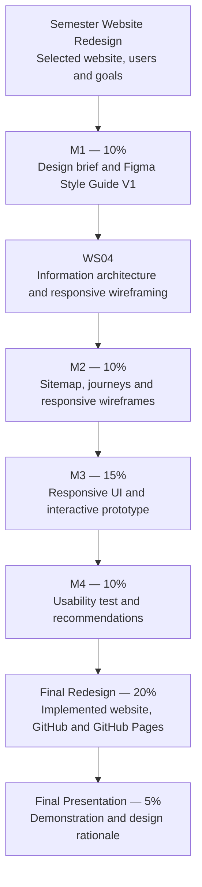
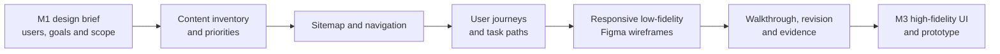
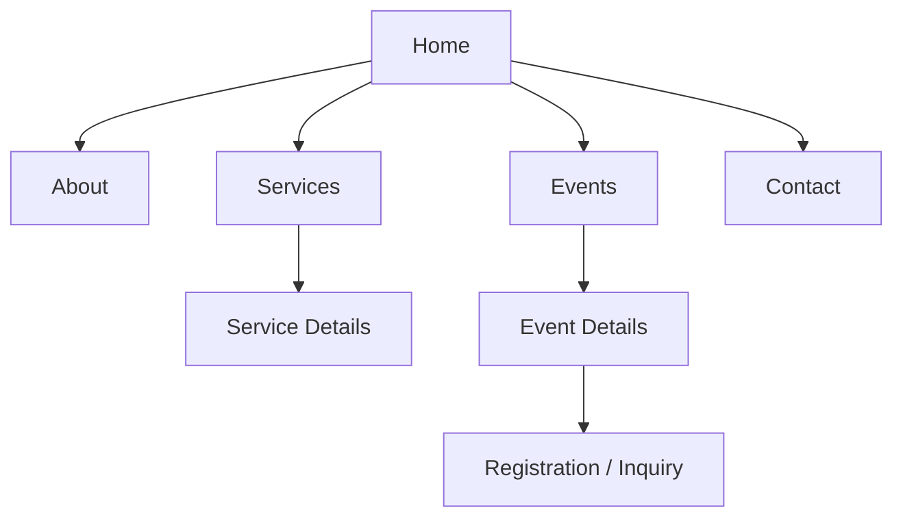

# WEBD 3100 — Project Milestone 2: Information Architecture, Sitemap & Responsive Figma Wireframes

**Semester Website Redesign Project — Student Assignment | Fall 2026**  
**Instructor:** Davis Boudreau  
**Assessment:** Milestone 2 — **10%** of final course grade  
**Due date:** As posted in Brightspace  
**Delivery:** Individual semester redesign project; continue the **same Figma file** established in Milestone 1

---

## 1. Assignment Details

| Field | Description |
|---|---|
| Course | WEBD 3100 — Web Design Fundamentals |
| Assignment | Project Milestone 2 — Information Architecture, Sitemap & Responsive Figma Wireframes |
| Type | Independently developed semester website redesign project |
| Prior learning | WS01–WS03B and Milestone 1; especially WS04 Information Architecture & Responsive Wireframing |
| Tools | Figma, browser, Milestone 1 Design Brief and Style Guide V1, Brightspace; optional accessibility and annotation tools |
| Assessment weight | **10%** |
| Submission | One PDF or DOCX project report to Brightspace, including the working Figma file URL; editable Figma artifacts are the authoritative design deliverables |
| Project continuation | M1 Design Brief & Style Guide → **M2 Sitemap & Responsive Wireframes** → M3 Responsive UI & Interactive Prototype → M4 Usability Test & Recommendations → Final Redesign & Presentation |

## 2. Overview — Purpose and Why This Matters

A successful redesign needs more than an attractive visual system. Users must be able to **find information, understand navigation, and complete important tasks** on screens of different sizes. Information architecture establishes what content exists and how it is organized; wireframes test that structure before time is invested in detailed visual styling or implementation.

**Your task is to extend your existing semester redesign project by developing a defensible sitemap, task-oriented user journeys, and responsive low-fidelity wireframes in Figma.** This is an independent application of the concepts practiced in WS04, not a reproduction of its guided NSCC case study.

**Learning progression:** Review → Inventory → Organize → Map → Trace User Tasks → Wireframe → Compare Viewports → Test → Revise → Document → Reflect.

### Success criteria

By the end of Milestone 2, you will have:

- A content inventory and clear information architecture aligned with your Milestone 1 users and redesign goals.
- A readable, hierarchical sitemap showing the intended website structure and navigation.
- At least **two distinct user journeys** tied to realistic user goals.
- **Three representative page types** designed as low-fidelity Figma wireframes at **mobile, tablet, and desktop** widths: **nine wireframes total**.
- Evidence of navigation and layout decisions, peer or scenario-based walkthroughs, and meaningful revisions.
- A coherent, organized Figma file and a professional report that explains the work and points to editable evidence.

**Scope boundary:** M2 evaluates **structure, content priority, navigation, responsive behavior, and usability reasoning**. High-fidelity visual styling, polished component libraries, complete interactive prototypes, production HTML/CSS, and published websites are **not required** for M2. Those are developed in later stages.

## 3. Semester Project & Milestone Roadmap

**One redesign. Four milestones. One final delivery.** Continue the same selected website, project name, and persistent Figma file used for M1. Explain any significant change in scope rather than silently replacing the project.



| Stage | Weight | Main deliverable | Boundary |
|---|---:|---|---|
| M1 | 10% | Design brief and Figma Style Guide V1 | Established users, scope, and visual foundations |
| **M2** | **10%** | Sitemap, user journeys, responsive Figma wireframes | **Required now:** navigable information structure and responsive low-fidelity design |
| M3 | 15% | Responsive high-fidelity UI and interactive Figma prototype | Visual refinement and interactions |
| M4 | 10% | Usability test, findings, recommendations | Evidence-based evaluation and iteration |
| Final Website Redesign | 20% | Implemented, tested website | GitHub source and live GitHub Pages URL |
| Final Presentation | 5% | Design-to-implementation demonstration | Explain and defend design decisions |

### Semester-wide artifact management and publishing policy

**Figma — authoritative design source.** Maintain **one persistent, instructor-accessible Figma file** across all milestones. Add clearly named pages or sections for the M2 content inventory, sitemap, journeys, responsive wireframes, walkthrough evidence, and revisions. Keep the M1 brief and style guide accessible; do not replace the file or flatten editable artifacts into screenshots.

**GitHub — authoritative implementation source.** When implementation begins, maintain **one persistent GitHub repository** for the redesign's HTML, CSS, JavaScript where applicable, assets, documentation, and testing evidence. **A repository or production code is not required in M2.**

**GitHub Pages — published implementation.** Publish the final working website through GitHub Pages and supply its public URL in the final assessment. **GitHub Pages is not required in M2.** A Figma prototype does not substitute for the implemented website.

**Brightspace — official assessment submission.** Submit the M2 report with a direct, tested Figma file link. Add GitHub and GitHub Pages URLs in later assignments when applicable. Use a consistent project name across all platforms.

| Stage | Figma | GitHub | GitHub Pages |
|---|---|---|---|
| **M2** | **Required: editable sitemap, journeys, wireframes, and revisions** | Optional setup only | Not required |
| M3 | Required: UI design and prototype | Begin/maintain repository as specified in M3 | Not yet required |
| M4 | Required: findings and design revisions | Maintain implementation changes where applicable | Use if working site available, as specified in M4 |
| Final Redesign | Required: final design/handoff | Required: complete source | Required: live published website |

### Milestone 2 design handoff



**Instructor verification goal:** The instructor must be able to open your Figma file, understand the site structure, follow both user journeys, compare the same three page types across all three viewport widths, inspect your annotations, and identify improvements made after testing.

## 4. Learning Outcomes Addressed

This milestone supports the course's established learning outcome areas (consult the approved course outline for authoritative wording):

- **Apply design principles:** Organize content and navigation for usability, clarity, hierarchy, and accessibility.
- **Design website mock-ups:** Produce and refine responsive low-fidelity page designs in Figma.
- **Prepare for implementation:** Document layout and responsive decisions that can later be translated into HTML/CSS.
- **Professional practice:** Maintain organized design evidence, justify decisions, and communicate design intent.

**Not yet assessed in full:** implementing the design as a complete coded website or delivering a finished interactive high-fidelity prototype.

## 5. Prior Knowledge and Readiness

Before beginning, confirm that you can:

- Open the **same Figma file** used for Milestone 1 and verify the instructor can access it.
- Locate your M1 project statement, intended users, primary tasks, redesign scope, and Style Guide V1.
- Explain the difference between a **content inventory**, **sitemap**, **user journey**, and **wireframe**.
- Create editable Figma frames, text, shapes, reusable elements, and clearly labeled pages/sections.
- Compare a mobile-first layout with tablet and desktop layouts.

**Checkpoint 0 — Project continuity:** Record your M1 project name, original website/reference URL, two target user groups or personas (where applicable), three primary user needs, and the current Figma URL. If your project direction changed, document the change and reason before continuing.

## 6. Project Description and Use Case

Use the **same student-selected website redesign** approved or established in M1. Your website may represent an organization, service, community initiative, event platform, small business, or another appropriate scenario. The redesigned structure must reflect actual user goals and a plausible content model, not placeholder pages chosen only to meet a numeric requirement.

### Required scope

1. Define the intended website structure in a sitemap that includes **at least six meaningful pages or destinations**. More are acceptable if justified; avoid unnecessary complexity.
2. Select **three representative page types** from that sitemap for responsive wireframing:
   - **Home or primary landing page**;
   - **Primary information/content page** (for example, service details, event details, or program information);
   - **Task-oriented page** (for example, registration, contact, inquiry, booking request, or another meaningful user action).
3. Build each of the three page types at **mobile (~375 px), tablet (~768 px), and desktop (~1280 px)** frame widths. These are reference widths, not claims that all devices have those exact dimensions.
4. Develop **two realistic user journeys**, each with a distinct goal, entry point, sequence of steps, and successful outcome.
5. Test the design using at least **two task walkthroughs**, record observations, and make at least **three specific revisions** supported by the findings.

**If your project does not naturally contain a form**, choose a different legitimate task-oriented page and explain why. Do not invent a fake checkout or registration flow just to meet the requirement.

## 7. Tasks and Instructions — What, Why, How

### Part A — Reconfirm the project and audit the content

**What:** Review the M1 brief and produce a content inventory for the redesign.

**Why:** Navigation cannot be designed responsibly until the designer knows what content users need, what can be consolidated, and what should be removed or added.

**How:**

1. Revisit the original website or reference scenario and list the existing or proposed content areas.
2. For each item, record its intended audience, purpose, priority, and proposed action: **keep, revise, combine, add, or remove**.
3. Identify at least **six meaningful destinations** and the three most important user tasks.
4. Note content gaps, duplicate labels, or confusing terminology.

| Content/page | Primary audience | User need | Priority | Action | Reason |
|---|---|---|---|---|---|
| Example: Services | New visitor | Understand available services | High | Revise | Current labels are unclear |

**Checkpoint A:** The inventory supports the M1 users and provides enough information to build a sitemap. Do not treat a list of arbitrary page names as an analyzed inventory.

### Part B — Create the hierarchical sitemap and navigation model

**What:** Build an editable sitemap in Figma showing parent/child relationships and the proposed navigation hierarchy.

**Why:** The sitemap makes information relationships visible before they are translated into page layouts.

**How:**

1. Group content into understandable categories using user-oriented labels.
2. Identify the homepage, primary navigation, second-level pages, and any relevant footer or utility destinations.
3. Show connecting relationships clearly with shapes, lines, labels, or an equivalent editable diagram.
4. Highlight the three pages selected for responsive wireframes.
5. Explain any content consolidation, renaming, or navigation changes from the existing site.

**Example structure — adapt to your own project:**



**Checkpoint B:** A first-time visitor can understand where to find key information, and every destination has a clear parent or intentional navigation route.

### Part C — Model two user journeys

**What:** Document two distinct, task-oriented journeys in the same Figma file.

**Why:** A sitemap describes the content structure; a user journey tests whether that structure helps people achieve goals.

**How:** For each journey, identify the user, goal, starting point, decision points, page sequence, intended success state, and possible friction. Trace the journey across actual sitemap destinations.

| Journey | User and goal | Entry point | Page/path sequence | Success condition | Potential friction |
|---|---|---|---|---|---|
| J1 | Example: Visitor finds service eligibility | Home | Home → Services → Service Details | Requirements understood | Unclear service names |
| J2 | Example: Visitor makes an inquiry | Service Details | Service Details → Contact | Inquiry completed | Form too long |

**Checkpoint C:** Each journey is plausible, complete, and consistent with the sitemap; journeys must not depend on pages that do not exist in your proposed structure.

### Part D — Build responsive low-fidelity wireframes in Figma

**What:** Produce **nine editable wireframes**: three page types × three viewport widths.

**Why:** A responsive design must change layout and priority appropriately rather than simply shrinking a desktop screenshot.

**How:**

1. Start with **mobile (~375 px)** for each selected page; establish content order and the essential task.
2. Expand to **tablet (~768 px)**, reconsidering columns, navigation, grouping, and spacing.
3. Expand to **desktop (~1280 px)**, using additional space to improve readability and hierarchy without hiding essential content.
4. Use neutral shapes, concise labels, placeholder image blocks, and realistic content headings. **Keep these low fidelity**; avoid spending assessment time on finished colours or polished illustration.
5. Label each frame with page type and viewport; organize the nine frames so matching page types can be compared side by side.
6. Annotate key responsive changes: navigation transformation, stacking/reordering, content priority, columns, and task controls.
7. Use your M1 style guide as a **reference for future design continuity**, not as a reason to convert the wireframes into high-fidelity mock-ups.

| Page type | Mobile ~375 px | Tablet ~768 px | Desktop ~1280 px |
|---|---|---|---|
| Home / landing | Required | Required | Required |
| Primary content / detail | Required | Required | Required |
| Task-oriented | Required | Required | Required |
| **Total** | **3** | **3** | **3** |

**Checkpoint D:** All nine frames exist, are editable, have a consistent page identity across viewports, and preserve access to the primary task. Show **what changes** between breakpoints, not merely that the frame becomes wider.

### Part E — Walk through, test, and refine

**What:** Evaluate the proposed navigation and wireframes against the two journeys and revise them.

**Why:** Early testing exposes structural problems before high-fidelity design or code makes them expensive to change.

**How:**

1. Prepare two task prompts corresponding to your user journeys. Do not tell the participant exactly which navigation item to click.
2. Conduct a peer walkthrough where possible; otherwise perform a documented scenario-based heuristic walkthrough and explicitly label it as such.
3. Record where the user expects to navigate, confusion or hesitation, missed content, and any viewport-specific obstacles.
4. Make **at least three meaningful revisions** across the sitemap, navigation, page layouts, or annotations.
5. Preserve before/after evidence using clearly named Figma sections, duplicates, or version history references.

| Task | Method / participant | Observation | Impact | Design change | Retest result |
|---|---|---|---|---|---|
| Example: Find registration | Peer walkthrough | Action buried below unrelated content | High | Moved CTA near event details | Participant located action |

**Checkpoint E:** Findings are specific and linked to changes. Statements such as “the design looks better” do not constitute testing evidence.

### Part F — Document design decisions and prepare handoff

**What:** Prepare a concise but complete project report and verify the Figma artifact.

**Why:** The next milestone requires enough rationale and structure to turn wireframes into consistent high-fidelity UI designs.

**How:**

1. Explain how the M1 brief influenced your sitemap and wireframes.
2. Include screenshots or exported views **as evidence**, while retaining the **editable originals in Figma**.
3. Describe the most significant responsive adaptations and usability decisions.
4. Summarize testing, revisions, limitations, and priorities for M3.
5. Confirm Figma sharing permissions and test the submitted link.

**Checkpoint F:** A reviewer can find and inspect every assessed artifact without searching through unlabeled frames or requesting access.

## 8. Required Deliverables and Evidence Map

Use these IDs and headings in the report. The Figma file is the source of truth for editable design work; the report explains decisions and identifies evidence.

| ID | Required deliverable | Report evidence (Brightspace) | Editable evidence (Figma) | Instructor verification |
|---|---|---|---|---|
| **D1** | Project continuity and M1 alignment | Project name, M1 goals/users, original/reference URL, scope changes and rationale | Existing M1 brief and Style Guide V1 remain accessible | Same redesign project is continued |
| **D2** | Content inventory and priorities | Inventory table with purpose, audience, priority, keep/revise/combine/add/remove decisions | `05 — Information Architecture & Sitemap` section or linked editable table | Proposed destinations follow user needs |
| **D3** | Hierarchical sitemap and navigation | Legible sitemap image and explanation of labels, grouping, and key changes; **6+ meaningful destinations** | Editable sitemap, including navigation hierarchy and selected page markers | Structure is coherent and navigable |
| **D4** | Two user journeys | Two task paths with users, goals, entry points, steps, success criteria and friction | Editable journey diagrams or tables | Journeys map to actual sitemap pages |
| **D5** | Responsive wireframes | Overview of **9 frames**; comparison and responsive annotations for each page type | **3 page types × 3 widths** in editable, labeled frames | Mobile, tablet and desktop decisions are meaningful |
| **D6** | Walkthroughs and iterations | Two task walkthroughs, observations, **3+ revisions**, before/after evidence | `09 — Usability Testing & Iterations` or M2 test/revision section | Findings lead to traceable design changes |
| **D7** | Handoff, reflection and access | Reflection answers, M3 priorities, working Figma URL, clearly identified file sections | Persistent, organized Figma file; M1 work preserved | Instructor can open and inspect artifacts |

**Evidence rule:** Every screenshot or diagram included in the report should have a caption explaining **what it shows and what design decision or result it supports**. A screenshot alone does not replace the editable Figma original.

## 9. Required Persistent Figma File Organization

Maintain the **same Figma file created for M1**. The following is the recommended semester structure; preserve M1 sections and add the M2 artifacts in the relevant locations.

```text
WEBD3100 — Semester Website Redesign — [Project Name]
│
├── 00 — Project Overview & Design Brief       [M1 — retain]
├── 01 — Visual Research & Design Critique    [M1 — retain]
├── 02 — Colour System                        [M1 — retain]
├── 03 — Typography System                    [M1 — retain]
├── 04 — Components & Design Tokens           [M1 — retain]
├── 05 — Information Architecture & Sitemap  [M2 — inventory + sitemap]
├── 06 — Responsive Wireframes                [M2 — 9 labeled frames]
│   ├── Home — Mobile / Tablet / Desktop
│   ├── Content — Mobile / Tablet / Desktop
│   └── Task — Mobile / Tablet / Desktop
├── 07 — High-Fidelity UI Design              [M3 — future]
├── 08 — Interactive Prototype                [M3 — future]
├── 09 — Usability Testing & Iterations       [M2 evidence; M4 expanded later]
└── 10 — Final Design & Handoff               [Final — future]
```

Place the **two user journeys** in section `05`, and record M2 walkthroughs and revisions in section `09` or in a clearly named `M2 — Testing & Revisions` subsection. Do not create empty decorative frames for future stages solely to mimic the structure.

### Figma handoff checklist

- [ ] The submitted URL opens the **existing semester file**, not a duplicate.
- [ ] The instructor has **view access** to all assessed sections; editable source remains in the file.
- [ ] The sitemap and journeys are legible and appropriately labeled.
- [ ] All nine wireframes are editable, labeled, and easy to compare.
- [ ] M1 artifacts remain accessible for continuity.
- [ ] Revision evidence is clearly marked and distinguishable from the current design.

## 10. Report Template — Required Headings

Prepare **one PDF or DOCX report** with the following headings:

1. **Cover and project identification** — course, milestone, student identifier, project name, submission date, Figma URL.
2. **D1 — Project continuity and M1 alignment** — goals, users, scope and any changes.
3. **D2 — Content inventory and priorities** — inventory table and rationale.
4. **D3 — Sitemap and navigation model** — sitemap evidence and explanation.
5. **D4 — User journeys** — two journeys and task-path reasoning.
6. **D5 — Responsive Figma wireframes** — nine-frame overview, responsive comparisons, annotations.
7. **D6 — Walkthroughs, findings and revisions** — tasks, observations, changes, before/after evidence.
8. **D7 — Reflection and Milestone 3 handoff** — reflection answers, limitations, next actions, tested Figma URL.

Use readable diagrams and captions. Large sitemap images may be placed on landscape pages or referenced through the Figma file when needed; the report must still explain the design.

## 11. Reflection Questions

Answer in complete, project-specific statements. Reference Figma frames or evidence where useful.

1. Which two or three user needs most strongly shaped your information architecture, and why?
2. Which content labels or groupings changed from the original site or your initial inventory? What problem did the changes address?
3. How does each of your two user journeys validate the proposed sitemap? Where could a user still get lost?
4. Describe **two meaningful responsive changes** between mobile, tablet, and desktop. Why are they appropriate for your content and tasks?
5. What did the walkthroughs reveal that you did not anticipate? Identify at least one revision supported by the evidence.
6. Which design decisions remain uncertain, and what will you test or refine during Milestone 3?

**Reflection standard:** Explain your own decisions and evidence rather than repeating definitions from WS04.

## 12. Evaluation Rubric — 100 Points (10%)

| Criterion | Points | What strong evidence demonstrates |
|---|---:|---|
| Project continuity, content inventory and prioritization | **15** | M1 alignment; clear users and goals; complete inventory with meaningful keep/revise/combine/add/remove decisions |
| Sitemap and navigation architecture | **20** | **6+ purposeful destinations**, coherent hierarchy, clear labels and navigation rationale |
| User journeys and task alignment | **15** | Two realistic, distinct journeys; complete task paths consistent with sitemap; attention to friction and outcomes |
| Responsive low-fidelity Figma wireframes | **30** | **Nine editable frames**, three meaningful page types, mobile/tablet/desktop adaptations, clear hierarchy, appropriate navigation and task access |
| Walkthrough testing and evidence-based iteration | **10** | Two documented walkthroughs, interpretable findings, **3+ meaningful revisions**, traceable before/after evidence |
| Documentation, Figma organization and professional reflection | **10** | Accessible persistent Figma file, complete report, labeled artifacts, clear rationale and M3 handoff |
| **Total** | **100** | **Milestone 2 contributes 10% to the final course grade** |

**Evaluation note:** A polished visual appearance does not compensate for missing information architecture or incomplete responsive frames. The focus is on the quality and defensibility of the structure and design decisions.

## 13. Student Deliverables and Submission Guidelines

### Submit to Brightspace

- **One complete PDF or DOCX Milestone 2 Project Report**, using the required D1–D7 headings.
- A **direct Figma file URL** in the report and, if Brightspace provides a link field, there as well.
- Suggested filename: `WEBD3100_M2_<student-identifier>.pdf` (or `.docx`).

### Maintain in Figma

- M1 design brief and style guide (retained).
- M2 content inventory, editable sitemap, two journeys, **nine responsive wireframes**, annotations, testing evidence, and revisions.
- Clear frame/page names and current versions that can be distinguished from drafts.

### Not required for M2

- GitHub repository, source code, GitHub Pages URL, complete high-fidelity prototype, or a deployed website.
- ZIP archive or flattened Figma export as the primary design submission.

### Final submission checks

- [ ] All seven deliverables D1–D7 are addressed.
- [ ] The Figma link works and the instructor can view the file.
- [ ] The sitemap includes at least six meaningful destinations.
- [ ] Two user journeys align with the sitemap.
- [ ] Nine wireframes exist and are clearly named.
- [ ] Two walkthroughs and at least three revisions are documented.
- [ ] The report includes all six reflections and M3 priorities.
- [ ] The correct PDF/DOCX is submitted to Brightspace before the posted deadline.

## 14. Completion and Exit Evidence

Milestone 2 is complete when your **project goals, content inventory, sitemap, journeys, wireframes, and test findings tell a consistent story**. The instructor can verify how users move through the proposed site and how the interface adapts across mobile, tablet, and desktop.

**Next milestone:** Use the sitemap and low-fidelity wireframes to build **responsive high-fidelity UI designs and an interactive Figma prototype** in M3. Continue the same Figma file and preserve the M2 design rationale so that later implementation can be traced to earlier decisions.

## 15. Resources and Equipment

- **WS04 — Information Architecture & Responsive Wireframing**, including the guided case study and testing exercises.
- **Milestone 1** project brief and Figma Style Guide V1.
- **Figma** for editable sitemap, journey diagrams, responsive frames, annotations, and versioned revisions.
- A modern browser for reviewing the existing site and researching navigation patterns.
- **Brightspace** for the formal report submission and posted due date.
- **Design System Studio V4.1** as an optional reference for later design consistency; it is not a substitute for your own IA and wireframes.

## 16. Academic Integrity, Accessibility, and Copyright

- Produce **original project-specific analysis and design work**. You may reference workshop examples, but do not submit the guided NSCC example as your independent milestone.
- Cite or credit external research, reference sites, borrowed assets, or design inspirations used to inform decisions.
- Use respectful, inclusive language, clear headings, logical navigation, readable annotations, and accessible task flows.
- Do not include private user information, real customer submissions, or credentials in reports or Figma artifacts.
- Collaborators may provide usability feedback, but each student is responsible for their own analysis, Figma design, evidence, and reflection unless the instructor expressly approves group work.

---

**WEBD 3100 • Milestone 2 • Fall 2026**  
**Design → Structure → Wireframe → Test → Refine → Document → Prepare for M3**
