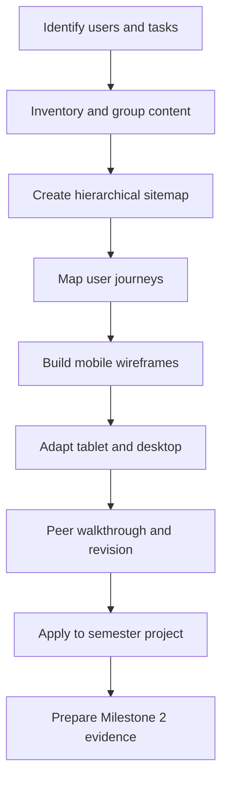
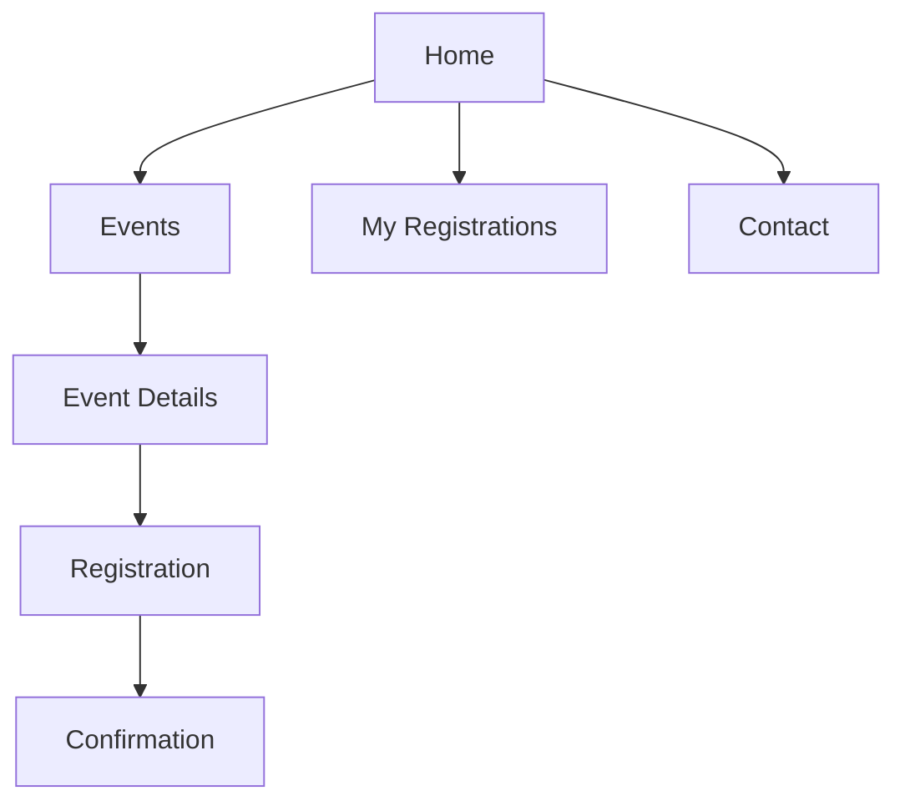

# WEBD 3100 — Workshop 04

## Information Architecture & Responsive Wireframing

**Student Workshop Guide | Fall 2026**

| Workshop detail | Information |
|---|---|
| **Instructor** | Davis Boudreau |
| **Assessment** | Workshop 04 — **4%** |
| **Format** | Self-guided, hands-on; instructor-facilitated review |
| **Estimated duration** | 3–4 hours of guided work, plus independent project refinement |
| **Prerequisites** | WS02 — Visual Design Principles; WS03A — Colour; WS03B — Typography |
| **Tools** | Figma, web browser, VS Code, Git/GitHub (when applicable), Brightspace |
| **Project alignment** | **Milestone 2 — Sitemap + Responsive Figma Wireframes (10%)** |

> **Workshop challenge:** Organize a website around real user tasks, construct a logical sitemap, and translate that structure into mobile-first wireframes for mobile, tablet, and desktop. Practise with an NSCC event-management example, then apply the same process to your semester redesign project.

**Assessment note:** Workshop 04 (4%) and Milestone 2 (10%) are **separate evaluations**. Your workshop artifacts are working drafts that you will refine for M2.

---

## 1. Workshop overview

A website may look attractive yet fail if visitors cannot locate information or complete their tasks. **Information architecture (IA)** determines how information is grouped, named, and connected. A **sitemap** represents relationships between pages. A **user journey** describes the steps needed to accomplish a goal. A **wireframe** represents page structure and content priority before high-fidelity styling.

In WS03A and WS03B, you developed colour and typography foundations. WS04 shifts the focus from **visual appearance** to **information organization and responsive structure**. These foundations will later support the high-fidelity Figma design and prototype.

### Learning objectives

By the end of the workshop, you should be able to:

1. Inventory website content and group it according to user needs.
2. Design a hierarchical sitemap with understandable navigation labels.
3. Map at least two user journeys and identify potential obstacles.
4. Build low-fidelity, mobile-first wireframes in Figma.
5. Adapt layouts and navigation for tablet and desktop viewports.
6. Review wireframes for clarity, task flow, responsive behaviour, and accessibility.
7. Record decisions, peer feedback, and improvements for Milestone 2.

### Workshop learning journey

---

## 2. Prior knowledge and preparation — 10 minutes

Before opening Figma, answer these questions in your **Workshop 04 Worksheet**:

1. How does a sitemap differ from a navigation menu?
2. Why is it useful to organize content before choosing colours and fonts?
3. Why is a mobile wireframe more than a smaller desktop wireframe?
4. What could prevent a visitor from completing an event registration?

**Observe and discuss:** Examine two familiar websites. Choose a task such as finding contact information. Which website makes the task easier? Explain what you observed rather than simply saying which one looks better.

**Checkpoint 0:** Record one good navigation decision and one potential navigation problem.

---

## 3. Concepts and worked example — 15 minutes

| Concept | What it means | Question to ask |
|---|---|---|
| **Content inventory** | List of pages, content, and features | What information must the site contain? |
| **Information architecture** | Organization and naming of content | Where does each item belong? |
| **Sitemap** | Page hierarchy and relationships | How are destinations connected? |
| **Navigation** | Interface used to move between destinations | Can visitors find the right page? |
| **User journey** | Steps to complete a goal | Can the visitor finish the task? |
| **Wireframe** | Low-fidelity page structure | What should appear first? |
| **Responsive layout** | Structure adapts to available space | What changes at narrower widths? |

### Worked example: Register for an event

A visitor wants to register for an NSCC event. The journey might be:

**Home → Events → Event Details → Registration → Confirmation**

Consider these questions:

- Which destinations should appear in the primary navigation?
- Should the Confirmation page be a top-level menu item?
- What details should be visible before someone selects **Register**?
- How would this journey work on a phone?

**Key distinction:** A sitemap shows *which pages exist and how they relate*. A wireframe shows *what appears within a page and how it is arranged*.

---

## 4. Part A — Information architecture — 60 minutes

### Activity A1 — Content inventory and grouping (15 minutes)

**Scenario:** You are redesigning an NSCC event-management website for students and community members.

Start with this inventory:

| Page or destination | Purpose |
|---|---|
| Home | Introduce the service and feature events |
| Events | Browse and filter available events |
| Event Details | Read date, location, and description |
| Registration | Complete an event registration |
| Confirmation | Confirm successful registration |
| My Registrations | Review or manage existing registrations |
| Contact | Request assistance |

**What to do**

1. Open Figma and create a page named `WS04 — IA & Wireframes`.
2. Add a frame named `Content Inventory`.
3. Create a labelled shape for each destination.
4. Group the destinations into **primary navigation**, **supporting navigation**, and **task-specific pages**.
5. Identify the three most important visitor tasks.
6. Explain why a task-specific page does not necessarily belong in the main menu.

**Checkpoint A1:** Record your proposed main navigation and justify at least one grouping decision in the worksheet.

### Activity A2 — Create a hierarchical sitemap (20 minutes)

A sitemap makes relationships visible before any page layouts are designed.

**What to do**

1. Create a Figma frame named `NSCC Sitemap`.
2. Use rectangles and connectors to show the hierarchy.
3. Clearly label every destination.
4. Distinguish primary destinations from pages reached during a task.
5. Check whether the sitemap supports each of your three visitor tasks.
6. Ask a peer to trace a route from Home to Registration without explanation.

**Checkpoint A2:** Save the sitemap and record one change you would make after the peer check.

### Activity A3 — Map two user journeys (25 minutes)

A user journey focuses on the visitor's goal, not just the page hierarchy.

Create two journeys in a Figma frame named `NSCC User Journeys`:

- **Journey 1:** Find an event and register.
- **Journey 2:** Find an existing registration **or** contact support.

For each journey, identify the action, page, obstacle, and possible improvement.

| Step | User action | Screen | Potential obstacle |
|---|---|---|---|
| 1 | Find upcoming events | Home | Events link is difficult to locate |
| 2 | Choose an event | Events | Event labels are unclear |
| 3 | Review event information | Event Details | Important details are buried |
| 4 | Submit registration | Registration | Form instructions are confusing |
| 5 | Confirm success | Confirmation | Success message is missing |

**Checkpoint A3:** Highlight the greatest potential obstacle in each journey and explain one design improvement.

---

## 5. Part B — Responsive Figma wireframing — 80 minutes

### Activity B1 — Build mobile-first wireframes (35 minutes)

**What:** Create two low-fidelity Figma frames at approximately **375px** wide:

- `Home — Mobile 375`
- `Event Details — Mobile 375` (or another important task page)

**Why:** A narrow screen forces you to prioritize content, reading order, and navigation. A wireframe should communicate structure without depending on final visual styling.

**What to do**

1. Create the first mobile frame in Figma.
2. Use grayscale blocks, short labels, and realistic placeholder text.
3. Include a header, navigation access, page heading, main content, primary call to action, and footer.
4. Place the most important task information early in the reading order.
5. Create the second mobile frame for your selected task page.
6. Annotate your navigation and content-priority decisions.

**Inspect your work:** Can someone understand the purpose of each control? Is the reading order logical? Would ordinary page content require horizontal scrolling? Are buttons and links reasonably easy to activate by touch?

**Checkpoint B1:** Record the two frame names and explain your most important mobile content decision.

### Activity B2 — Adapt for tablet and desktop (30 minutes)

Create two more versions of the **Home** page:

- `Home — Tablet 768`
- `Home — Desktop 1280`

These are **reference viewport widths**, not mandatory breakpoints for every site.

| Design decision | Mobile (~375px) | Tablet (~768px) | Desktop (~1280px) |
|---|---|---|---|
| Navigation | Compact and discoverable | Compact or expanded | Expanded when space permits |
| Content grid | Usually one column | Often two columns | Often multiple columns |
| Content order | Prioritize key task | Preserve logical reading order | Preserve hierarchy |
| Main call to action | Prominent and touch-friendly | Clearly prominent | Clearly prominent |

**What to do**

1. Duplicate the mobile Home frame twice and rename the copies.
2. Resize the frames to approximately 768px and 1280px.
3. **Reconsider the layout** rather than stretching every element.
4. Explore Figma **Auto Layout** for spacing, alignment, and resizing behaviour.
5. Annotate at least **three responsive decisions** involving navigation, grid, spacing, or content order.
6. Compare all three Home frames side by side.

**Checkpoint B2:** Explain what changes between the three layouts and what stays consistent.

### Activity B3 — Peer walkthrough and revision (15 minutes)

Ask another student to inspect your sitemap and wireframes. Give them this task without coaching:

> Find an upcoming event and show where you would register.

Record:

1. Whether the route was discoverable.
2. At least two observations or points of confusion.
3. One concrete revision you made in response.

**Checkpoint B3:** Add before/after annotations showing the change. This is an **informal formative walkthrough**, not the formal usability study assessed in Milestone 4.

---

## 6. Part C — Apply to your semester redesign project — 45–60 minutes, with independent refinement

The NSCC example is practice. You must now apply the process to **your own selected semester redesign project**.

In your course Figma workspace, create a section named `WS04 — Semester Project IA & Wireframes`.

Produce the following:

1. A content inventory and proposed primary navigation.
2. A hierarchical sitemap.
3. Two user journeys, including the most important visitor task.
4. A mobile Home wireframe and one mobile task-page wireframe.
5. Tablet and desktop adaptations of the Home page.
6. Three annotations explaining responsive layout choices.
7. Peer feedback and at least one documented revision.
8. A short design rationale connecting user needs to structure.

### Connection to WS03A and WS03B

Your **Colour System V1** and **Typography System V1** will inform the eventual visual design. However, keep these wireframes **low fidelity**. The purpose of WS04 is to validate structure and task flow before detailed styling and interactive prototyping.

Complete this statement in your worksheet:

> Our primary users need to ________. We organized the site around ________. On mobile, we prioritize ________. We will validate these decisions by ________.

**Project checkpoint:** Confirm that the sitemap and responsive wireframes describe the **same website** and support the **same primary user tasks**.

---

## 7. Testing, debugging, and checkpoints

| Checkpoint | Required evidence |
|---|---|
| 0 — Prior knowledge | Initial answers and navigation observation |
| A1 — Content organization | Inventory, groupings, navigation rationale |
| A2 — Sitemap | Figma hierarchy and peer route check |
| A3 — User journeys | Two journeys, obstacles, improvements |
| B1 — Mobile wireframes | Home and task page at approximately 375px |
| B2 — Responsive adaptation | Home at approximately 768px and 1280px; three annotations |
| B3 — Peer walkthrough | Two observations and one documented revision |
| Project application | Own-project sitemap, journeys, wireframes, and rationale |

### Common problems and solutions

| Problem | What to check |
|---|---|
| Sitemap looks like a page layout | Show pages and relationships, not page-level content blocks. |
| Every page appears in the main navigation | Distinguish primary destinations from task-specific pages. |
| Tablet layout is just a stretched phone screen | Reconsider columns, navigation, spacing, and content priority. |
| Wireframes look like finished mock-ups | Return to grayscale and focus on structure. |
| Peer feedback is only “looks good” | Ask the reviewer to complete a specific task and record observable behaviour. |
| Content order becomes confusing on desktop | Preserve a logical reading and keyboard navigation sequence. |

---

## 8. Worksheet, reflection, and closing review

### Workshop Worksheet questions

1. Which information-architecture decision most influenced your sitemap? Why?
2. What changed most between mobile and desktop layouts? Explain your reasoning.
3. Which part of the primary user journey might cause confusion?
4. What did your peer walkthrough reveal that you did not notice yourself?
5. What revision did you make, and how did it improve the design?
6. How will your WS03A colour and WS03B typography choices influence the final visual design?
7. What still needs to be completed or refined for Milestone 2?

### Instructor-led end-of-class review (10–15 minutes)

Be ready to show your sitemap and the three responsive Home frames. Explain **one design choice**, **one usability concern**, and **one revision**. The instructor may ask you to describe how a visitor completes the primary task.

---

## 9. Student deliverables and submission guidelines

**All students** complete the Workshop Worksheet during the activities. Record observations, design decisions, peer feedback, revisions, and reflection responses. Keep Figma frames organized and clearly labelled.

**In-class students:** Complete the worksheet and participate in the instructor-led review. **Do not submit the worksheet** unless the instructor directs otherwise.

**Absent students:** Complete the full workshop and worksheet independently and **submit the completed worksheet to Brightspace**.

**All students:** Complete the required **Brightspace reflection**, retain the Figma link and artifacts, and **commit/push technical evidence to GitHub when supporting technical files are created**. An empty GitHub commit is not required for Figma-only work.

### Evidence to retain

- Guided NSCC content inventory, sitemap, and user journeys.
- Guided NSCC mobile, tablet, and desktop wireframes.
- Own-project sitemap, user journeys, and responsive wireframes.
- Peer feedback and documented revision.
- Completed worksheet and reflection.
- GitHub link, if supporting HTML/CSS or other technical files were produced.

---

## 10. Workshop evaluation — 4%

The established workshop evaluation framework applies.

| Criterion | Evidence |
|---|---|
| **A — Attendance** | Attendance and engagement, or completion through the approved independent pathway |
| **P — Participation** | Discussion, peer walkthrough, and closing review |
| **T — Task Progress** | Sitemap, user journeys, responsive wireframes, revisions |
| **F — Focus & Professional Conduct** | Independent work, responsible tool use, constructive feedback |
| **R — Reflection / Exit Evidence** | Clear rationale, observations, lessons, and next steps |

**Workshop 04 remains worth 4%.** No new assessment category or weighting is introduced.

---

## 11. Milestone 2 readiness — Separate formal assessment (10%)

**Milestone 2: Sitemap + Responsive Figma Wireframes**

WS04 prepares you to create both components of M2. Before the milestone deadline, refine the workshop drafts into a coherent, reviewer-ready set of Figma artifacts.

| M2 component | Started in WS04 | Refine before M2 submission |
|---|---|---|
| Sitemap | Hierarchical site structure | Confirm page scope, labels, navigation relationships |
| Responsive wireframes | Mobile Home and task page; tablet/desktop Home | Complete the page coverage specified in the M2 brief |
| Design rationale | User journeys and responsive annotations | Explain choices, obstacles, and revisions |
| Figma organization | Clearly labelled workshop frames | Organize final deliverables for reviewer navigation |

> **Important:** The separate M2 assignment brief determines the final page count, required deliverables, submission method, and due date. WS04 does not replace or change that brief.

### Course progression

**WS03A + WS03B → Milestone 1 → WS04 → Milestone 2 → WS05 (Responsive UI & Interactive Figma Prototyping) → Milestone 3**

---

*WEBD 3100 — Workshop 04 | Information Architecture & Responsive Wireframing | Fall 2026*
